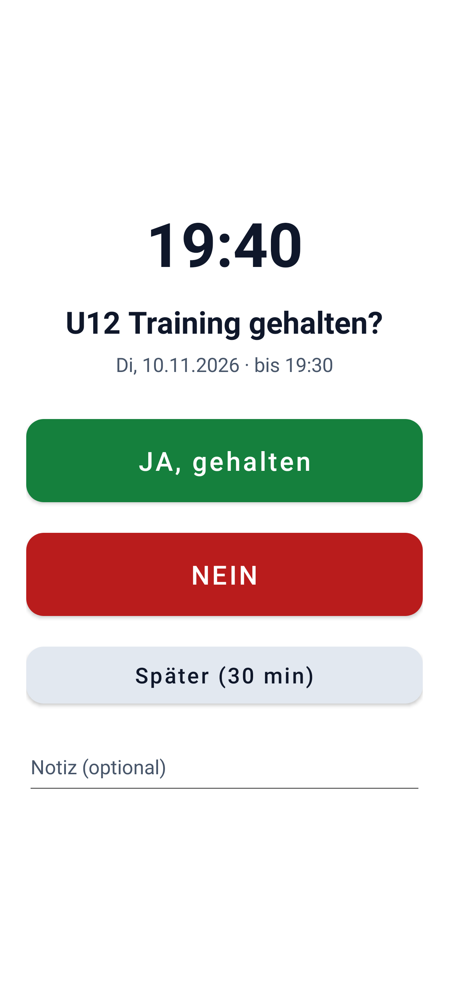
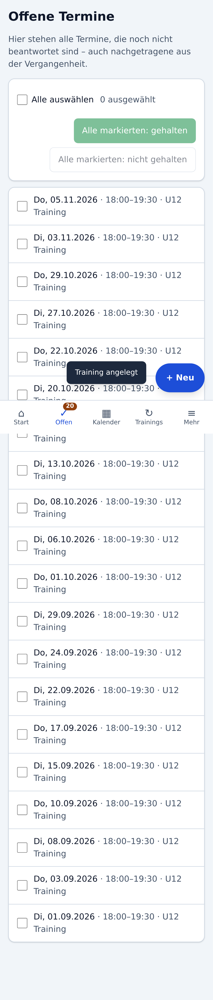
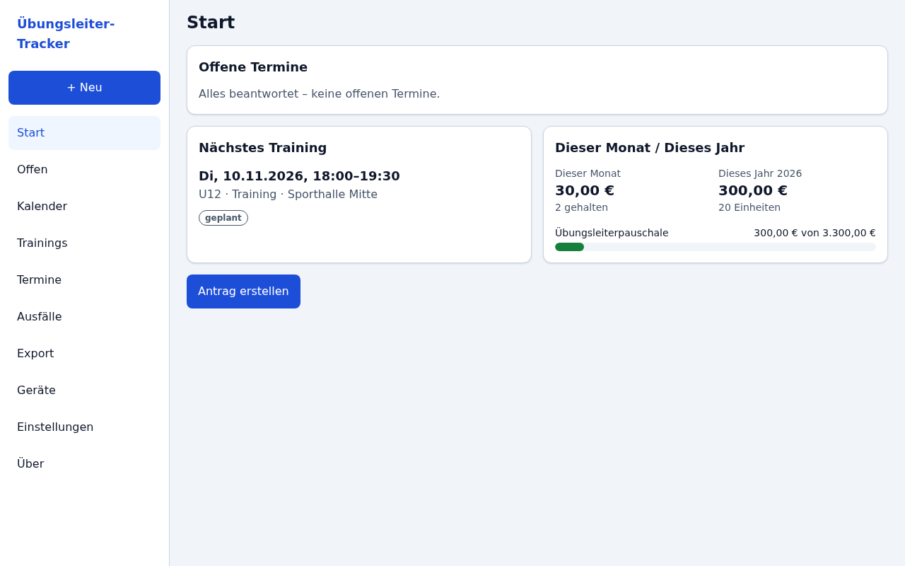
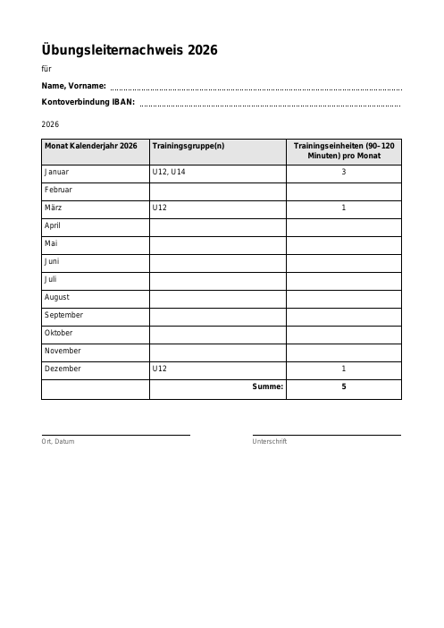

# Übungsleiter-Tracker

Nach jedem Training klingelt das Handy wie ein Wecker: **„U12 Training gehalten? JA / NEIN / Später“**.
Die Antworten werden gespeichert; am Jahresende erzeugt die App den **Übungsleiternachweis als PDF** im Format des Vereins.
Kostenlos, ohne Play Store, ohne Firebase – Open Source unter **AGPL-3.0-or-later**.

| Vollbild-Alarm (Android)             | Offene Termine (Handy)                     | Start (PC)                                   | Antrag-PDF                             |
| ------------------------------------ | ------------------------------------------ | -------------------------------------------- | -------------------------------------- |
|  |  |  |  |

## Funktionen

- **Vollbild-Alarm über dem Sperrbildschirm** (Android, `setAlarmClock` + Full-Screen-Intent), neustartfest,
  Online-Vorabprüfung (wer am PC schon geantwortet hat, wird nicht geweckt), Antworten offline zwischengespeichert.
- Nur das gewählte **Erinnerungsgerät** klingelt; Browser und andere Geräte fragen nur, wenn sie gerade offen sind.
- **Trainings** mit Wochentag-Chips (Mo–So), wöchentlich / alle 2 Wochen, Einzeltrainings, Spiele, Turniere.
- Bearbeiten wie im Kalender: **nur dieser / dieser und alle folgenden / alle Termine**.
- **Ferien & Ausfälle** (auch `.ics`-Import) – keine Termine, kein Alarm.
- **Nachtragen**: Startdatum in der Vergangenheit → offene Termine → „Alle markierten: gehalten“.
- **Übungsleiternachweis (PDF)** nach Kalenderjahr: Monat × Trainingsgruppe(n) × Einheiten, Summe, optional Detail-Anhang.
- Export **CSV / XLSX / JSON-Backup**, Import mit Vorschau und Duplikatprüfung. Alles im Browser erzeugt.
- Start-Seite mit Summen, Fortschritt der Übungsleiterpauschale und Antrags-Erinnerung ab 1.12.

## Architektur

```
Cloudflare (Free): 1 Worker = Hono-API /api/* + Web-App (Static Assets) + Cron (stündlich) · D1 (SQLite, Drizzle)
   ▲ Cookie-Session (GitHub-Login)               ▲ Bearer-Device-Token (Kopplung per QR-Code)
Browser (PC, iPhone, Tablet)                  Android-App = Capacitor-Hülle um dieselbe Web-App
                                                + Kotlin-Plugin „TrainingAlarm“ (AlarmManager, WorkManager)
```

| Ordner            | Inhalt                                                                                                      |
| ----------------- | ----------------------------------------------------------------------------------------------------------- |
| `packages/shared` | Domänenlogik ohne I/O: Zeit (Europe/Berlin, DST), Termin-Generator, Alarmzeiten, Antrag-Summen, zod-Schemas |
| `apps/api`        | Cloudflare Worker (Hono, Drizzle, D1), Cron, Tests mit `@cloudflare/vitest-plugin`                          |
| `apps/web`        | SvelteKit 2 + Svelte 5 + Tailwind 4 (SPA), PDF/XLSX/CSV/ICS clientseitig                                    |
| `apps/android`    | Capacitor 8 + Kotlin-Plugin, Robolectric/Roborazzi-Tests, Instrumented-Tests                                |
| `e2e`             | Playwright (Chromium, Firefox, WebKit, Pixel 7, iPhone 15) + axe                                            |

Entscheidungen: [`docs/DECISIONS.md`](docs/DECISIONS.md) · Fachliche Spezifikation: [`docs/SPEC.md`](docs/SPEC.md)

## Lokale Entwicklung

Voraussetzungen: Node 22, pnpm, JDK 21 + Android-SDK (nur für die App). Am einfachsten im Devcontainer (siehe `SETUP.md`).

```bash
pnpm install
cp apps/api/.dev.vars.example apps/api/.dev.vars   # Testmodus lokal
pnpm db:migrate:local && pnpm db:seed              # lokale D1 + Beispielserie „U12, Di 18:00–19:30“
pnpm dev                                           # API :8787 + Web :5173 → http://localhost:5173, „Test-Login“
```

| Befehl                                                   | Zweck                                                                                               |
| -------------------------------------------------------- | --------------------------------------------------------------------------------------------------- |
| `pnpm lint` / `pnpm check` / `pnpm test`                 | ESLint+Prettier / svelte-check+tsc / Vitest (shared, api, web)                                      |
| `pnpm build`                                             | Web-App + Worker (Dry-Run)                                                                          |
| `pnpm test:e2e`                                          | Playwright gegen `wrangler dev` mit gebauter Web-App (`E2E_BROWSERS=chromium-desktop` schränkt ein) |
| `pnpm android:build`                                     | Web-Build → `cap sync` → Debug-APK                                                                  |
| `pnpm android:lint` / `android:test` / `android:screens` | ktlint+detekt+Lint / Robolectric / Roborazzi-Screenshots                                            |
| `pnpm verify`                                            | alles zusammen (Definition of Done)                                                                 |

## Deploy

Push auf `main` → GitHub Actions (`deploy.yml`): D1 anlegen/migrieren, Secrets setzen, `wrangler deploy`.
Benötigte Secrets und die einmaligen Klicks stehen in [`docs/HUMAN_STEPS.md`](docs/HUMAN_STEPS.md).
Wöchentlich sichert `backup.yml` die Datenbank **verschlüsselt** als Actions-Artefakt.

## App installieren (Android)

1. Am Handy die neueste Version unter **Releases** öffnen → `app-release.apk` herunterladen und installieren
   („Installation aus unbekannten Quellen“ erlauben). Tipp: **Obtainium** hält die App automatisch aktuell.
2. App → „Gerät koppeln“ → am PC: Geräte → „Gerät koppeln“ → QR-Code scannen.
3. „Alarm-Einrichtung“ durchklicken, bis alles grün ist → „Test-Alarm in 1 Minute“.

## Lizenz

GNU Affero General Public License v3.0 oder später ([`LICENSE`](LICENSE)). Wer eine geänderte Version als Dienst
anbietet, muss den Quellcode bereitstellen – die App verlinkt ihn unter „Über“.

---

## English summary

**Übungsleiter-Tracker** helps a volunteer sports coach prove which trainings took place. After each scheduled training an
Android phone shows an alarm-clock-style full-screen prompt ("Training held? YES / NO / Later") over the lock screen.
Answers sync to a Cloudflare Worker + D1 (free tier). A SvelteKit web app (also bundled into the Capacitor Android app)
manages recurring trainings, holidays, bulk back-filling and exports the club's yearly report as PDF, plus CSV/XLSX/JSON.
Tech: pnpm monorepo, TypeScript, Hono, Drizzle, SvelteKit 2/Svelte 5, Tailwind 4, Capacitor 8, Kotlin (AlarmManager,
WorkManager), Vitest, Playwright, Robolectric, Roborazzi. Run `pnpm install && pnpm dev`; see the table above.
License: AGPL-3.0-or-later.
